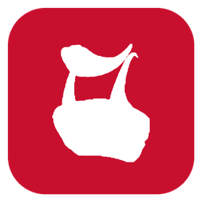
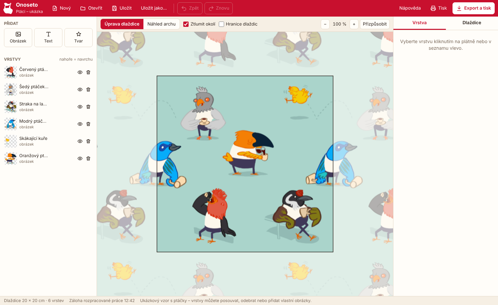

# Onoseto

Editor souvislých vzorů na balicí papír pro Windows. Do dlaždice skládáte obrázky, texty a tvary jako vrstvy – co přesáhne okraj dlaždice, objeví se na protější straně, takže vzor navazuje zleva doprava i shora dolů. Hotový papír uložíte jako PDF pro profesionální tisk, jako PNG, nebo ho rovnou vytisknete.

## Spuštění

1. Stáhněte repozitář: **Code → Download ZIP** a rozbalte ho kamkoli (třeba do Dokumentů).
2. Dvojklik na **Spustit Onoseto** – aplikace se otevře jako samostatné okno (přes Microsoft Edge). Nic se neinstaluje a funguje i bez internetu.
3. Ikonu na plochu a do nabídky Start přidá jednou spuštěný soubor **Vytvořit zástupce na ploše**.

Windows SmartScreen se může u spouštěcího souboru zeptat, jestli ho chcete spustit – zvolte *Další informace → Přesto spustit*.

## Složky

| Složka | Obsah |
|---|---|
| `aplikace` | samotná aplikace (`onoseto.html`), ikona a skript pro zástupce |
| `Projekty` | rozpracované vzory (`.json`) – otevřete je v aplikaci tlačítkem Otevřít |
| `Hotové papíry` | exporty pro tisk (PDF a PNG) |

Při prvním uložení se aplikace zeptá na složku. Vyberte **přímo složku, kam jste aplikaci rozbalil** – tu, ve které jsou složky `Projekty` a `Hotové papíry` (po stažení z GitHubu se může jmenovat `OnosetoGiftPaper-main`, klidně ji přejmenujte na `Onoseto`). Potom aplikace ukládá rovnou do těchto složek.

## Co umí

- vrstvy z obrázků, textu a tvarů (kruh, elipsa, obdélníky, hvězda, srdce, komiksové bubliny…), přetahování pořadí myší
- posun, změna velikosti a otáčení úchyty, přiblížení a posun pohledu
- opakování vrstvy v mřížce nebo náhodně rozsypané, obrys jako nálepka, stín, úpravy barev, odstranění jednobarevného pozadí
- pozadí jednobarevné, proužky, puntíky, šachovnice; převod celého vzoru do černobílé
- export PDF pro tisk: spadávka (výchozí 3 mm), ořezové a pasovací značky v registrační barvě, popisek, TrimBox a BleedBox, černobíle v odstínech šedi
- export PNG (celý arch nebo jedna dlaždice) s nastaveným DPI
- tisk přímo z aplikace
- projekty se ukládají do složky `Projekty`, rozpracovaná práce se navíc průběžně zálohuje uvnitř aplikace

Klávesové zkratky najdete v aplikaci pod **Nápovědou (F1)**, podrobnější postup v souboru [Návod.txt](Návod.txt).

## Požadavky

Windows 10 nebo 11 s prohlížečem Microsoft Edge (případně Google Chrome). Ukládání přímo do složek funguje jen v těchto prohlížečích.

---

© Onoseto Studio
